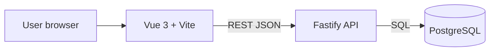
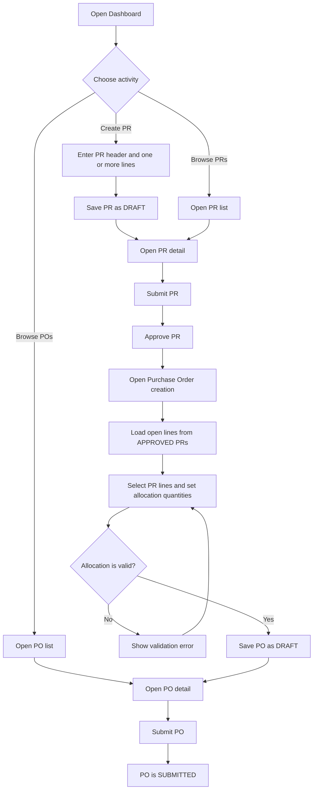
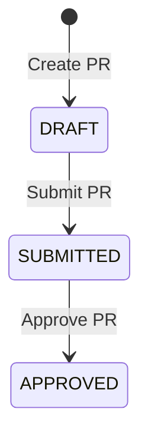
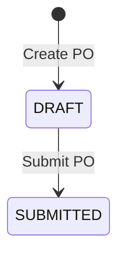
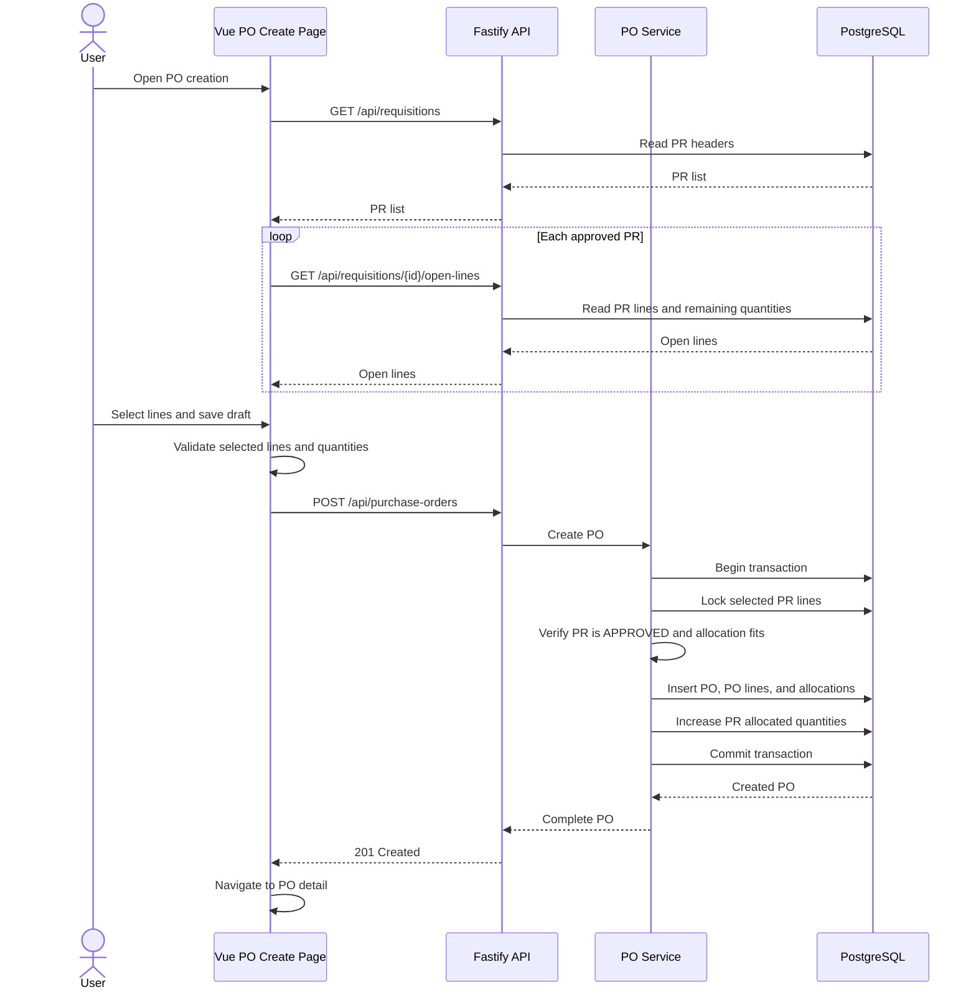
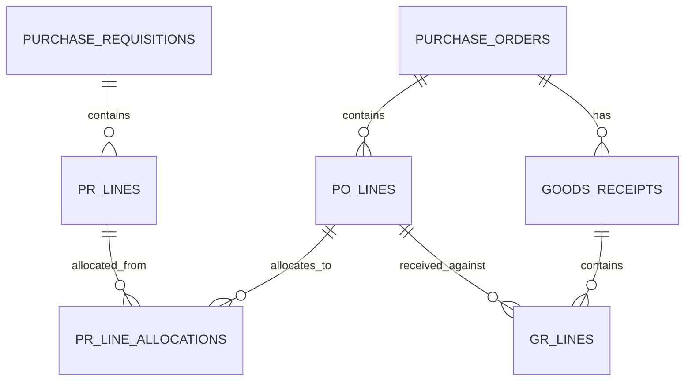

# Current Application Guide

## Overview

Procurement MVP is a Vue single-page application backed by a Fastify REST API and PostgreSQL. It supports the purchase requisition (PR) and purchase order (PO) stages of procurement:

1. Create, submit, and approve a PR.
2. Create a PO by allocating quantities from approved PR lines.
3. Submit the PO.

The database schema also includes Goods Receipt (GR) tables, but the current application has no GR API routes or user interface.

## Architecture

- The Vue application uses Vue Router for client-side routes.
- `frontend/src/api.js` is the shared HTTP client. It uses `VITE_API_BASE_URL`, defaulting to `http://localhost:3000`.
- Fastify route handlers delegate business rules and database access to service modules.
- PostgreSQL stores PRs, POs, their lines, and the allocation links between PR and PO lines.

## User Flow

## Pages and Navigation

| Route | Page | Current behavior |
|---|---|---|
| `/` | Dashboard | Shows PR counts by status and the five most recently created PRs. |
| `/requisitions` | PR list | Lists PR number, requester, department, title, status, and needed-by date. |
| `/requisitions/new` | PR creation | Collects PR header data and at least one item line, then saves a draft. |
| `/requisitions/:id` | PR detail | Shows the PR and its lines. A draft can be submitted; a submitted PR can be approved. |
| `/purchase-orders` | PO list | Lists PO number, vendor, status, and creation date. |
| `/purchase-orders/new` | PO creation | Loads open lines from approved PRs, then creates a draft PO with allocations. |
| `/purchase-orders/:id` | PO detail | Shows PO lines, their source PR allocations, receipt quantities, and the submit action for a draft. |

The persistent header links to Dashboard, Purchase Requisitions, and Purchase Orders.

## Purchase Requisition Workflow

### States

Only a `DRAFT` PR can be submitted, and only a `SUBMITTED` PR can be approved.

### Creation rules

A PR must include:

- Requester name, department name, and title.
- At least one line.
- For every line: item code, item name, unit of measure, site code, and a requested quantity greater than zero.
- Estimated unit price must not be negative.

Creating a PR generates a `PR-2026-####` number, inserts its header and lines in a transaction, and returns the complete PR as `DRAFT`.

## Purchase Order Workflow

### States

Only a `DRAFT` PO can be submitted.

### Allocation rules

PO creation is only available from the PO creation page, which loads open lines from PRs in the `APPROVED` state. A PO requires:

- A non-empty vendor name.
- At least one line.
- For every line: PR line ID, item code, item name, unit of measure, site code, and ordered quantity greater than zero.
- A unit price that is not negative.

The application validates allocation twice:

1. **Browser validation:** a PR line may be selected once and its allocation cannot be greater than the quantity shown as remaining.
2. **Server validation:** the service locks every selected PR line, verifies the parent PR is `APPROVED`, and ensures the combined allocation for each PR line does not exceed its remaining quantity.

On success, one transaction creates the PO header and lines, creates a `pr_line_allocations` row for every PO line, and increases `pr_lines.qty_allocated`. This prevents allocation beyond the requested quantity, including concurrent requests.

## Create-PO Sequence

## REST API

All responses are JSON. Invalid state transitions and invalid creation requests return `422` with a `message`; unknown PR and PO IDs return `404` with a `message`.

| Method | Endpoint | Description |
|---|---|---|
| `GET` | `/api/requisitions` | List PR headers. |
| `POST` | `/api/requisitions` | Create a draft PR and its lines. |
| `POST` | `/api/requisitions/:id/submit` | Move a PR from `DRAFT` to `SUBMITTED`. |
| `POST` | `/api/requisitions/:id/approve` | Move a PR from `SUBMITTED` to `APPROVED`. |
| `GET` | `/api/requisitions/:id` | Get a PR and its lines. |
| `GET` | `/api/requisitions/:id/open-lines` | Get PR lines with remaining quantity for PO allocation. |
| `GET` | `/api/purchase-orders` | List PO headers. |
| `POST` | `/api/purchase-orders` | Create a draft PO and allocate approved PR lines. |
| `POST` | `/api/purchase-orders/:id/submit` | Move a PO from `DRAFT` to `SUBMITTED`. |
| `GET` | `/api/purchase-orders/:id` | Get a PO, its lines, and their source PR allocations. |
| `GET` | `/api/purchase-orders/:id/open-lines` | Get PO lines with remaining quantity for future GR processing. |

## Data Relationships

Key quantity fields:

- `pr_lines.qty_requested`: quantity requested by the employee.
- `pr_lines.qty_allocated`: quantity committed to POs.
- `qty_open_for_po`: calculated as `qty_requested - qty_allocated`.
- `po_lines.qty_ordered`: quantity ordered from the vendor.
- `po_lines.qty_received`: quantity received through GR processing.
- `qty_open_for_gr`: calculated as `qty_ordered - qty_received`.

GR tables and the PO open-lines endpoint prepare for a future receiving module; no current UI or API creates or posts a goods receipt.
